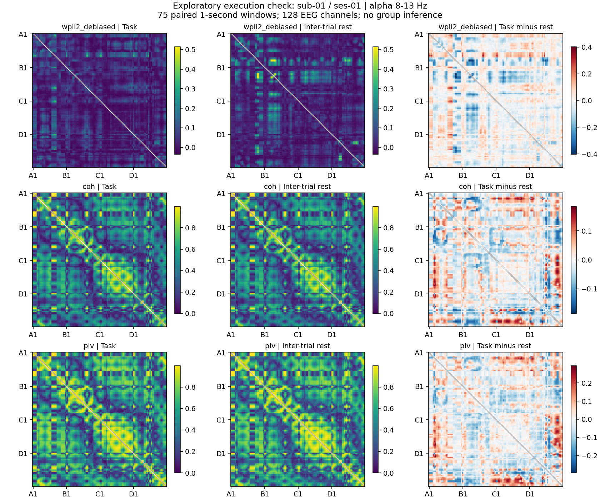

# Validation status — 2026-10-23

## Completed

- 14 automated tests pass on Python 3.11. Synthetic checks cover condition selection, malformed/missing markers, condition reset at run boundaries, status-bit masking, event timing after resampling, equal/valid windows, paired artifact rejection, known identical-channel coherence, symmetric plotting, duplicate-trial rejection, participant-level inference, missing-session refusal and CSP training-fold isolation.
- SHA-256 checks confirm that all 17 original code/notebook files match `SOURCE_MANIFEST.json` exactly.
- The five new notebooks pass nbformat validation. Their cells have not all been executed sequentially; the functions they call were checked through the CLI and synthetic tests.
- Actual BDF recording **sub-01 / ses-01**, 1,832 seconds at 1,024 Hz: 200 directional trials across experimental conditions. Strict parsing retained 199 complete sequences (one malformed pronounced-speech trial excluded). Inner-speech blocks contained 80 complete trials.
- Matched measured task/rest window bounds retained 78 inner-speech pairs; two had insufficient rest duration. Paired amplitude/flatness QC excluded three more, leaving **75 task/rest pairs**, each 1 second at 256 Hz and 128 scalp EEG channels.
- Continuous 1-40 Hz filtering, 50 Hz notch, average reference and EOG-guided ICA completed. ICA retained 42 PCA components at the configured 0.99 explained-variance setting and excluded components 0, 9 and 11. No ICA convergence warning was recorded. This remains automated QC, not manual artifact validation.
- All **8,128** unique EEG pairs were estimated for alpha-band debiased squared wPLI, coherence and PLV, with identical paired trials in task/rest. All saved connectivity values are finite.
- Within-participant leave-one-run-out CSP+LDA completed across two inner-speech runs: training/test counts 37/38 and 38/37. Balanced accuracies were **0.3111 and 0.3222** (raw accuracies 0.3158 and 0.3243). No significance, chance-level superiority or across-subject generalization is established by this execution check.
- Multitaper task/rest power computation completed; group inference correctly refuses this single-participant configuration.
- The completed QC record was augmented with the exact settings of that same run for cross-session compatibility checks. Computational preprocessing was not changed by this provenance-only addition; connectivity was then regenerated with the completed provenance record.

An initial attempt stopped before loading because the OS temporary drive lacked enough space. The rerun used a scratch directory on a drive with sufficient space; no EEG input files were changed. `preprocessing.scratch_dir` is now configurable and free space is checked before allocation. An actual-run JSON serialization issue in ICA component IDs was fixed before the successful rerun. A scikit-learn 1.4/MNE 1.10 incompatibility was resolved with scikit-learn 1.6.1; exact tested top-level package versions are in `requirements-tested.txt`.

## Not yet completed

- Full planned ten-participant, three-session processing and manual QC.
- Real-data group-level permutation statistics, effect estimates or corrected discoveries.
- Direction-specific contrasts, visualization-condition comparisons or source-space analysis.
- An independent replication or confirmatory study.
- Running the historical EEGNet inference attempt.

The group workflow was tested with synthetic participant/session inputs, not presented as an observed group result. The pipeline stops on missing planned sessions or mismatched channel/settings metadata instead of silently shrinking the sample.

## Example output

The following is a **descriptive single-session execution check**, not a significance map. Coherence and PLV can be inflated by sensor mixing. Axes identify sensor order, not anatomical regions. Each row's task/rest panels share a color scale; differences use a zero-centered scale.

Generated FIF, ICA, connectivity arrays, local paths and full QC/provenance records remain under ignored `results/generated/`; only this description and example figure are included in the repository.
